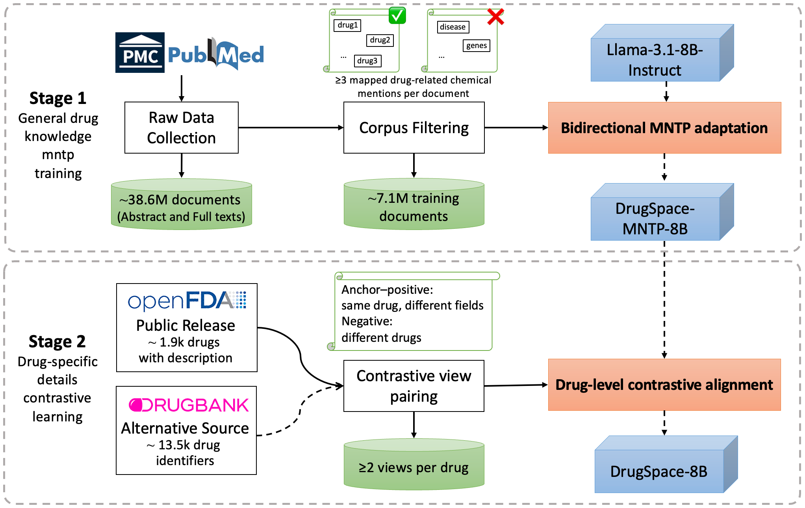
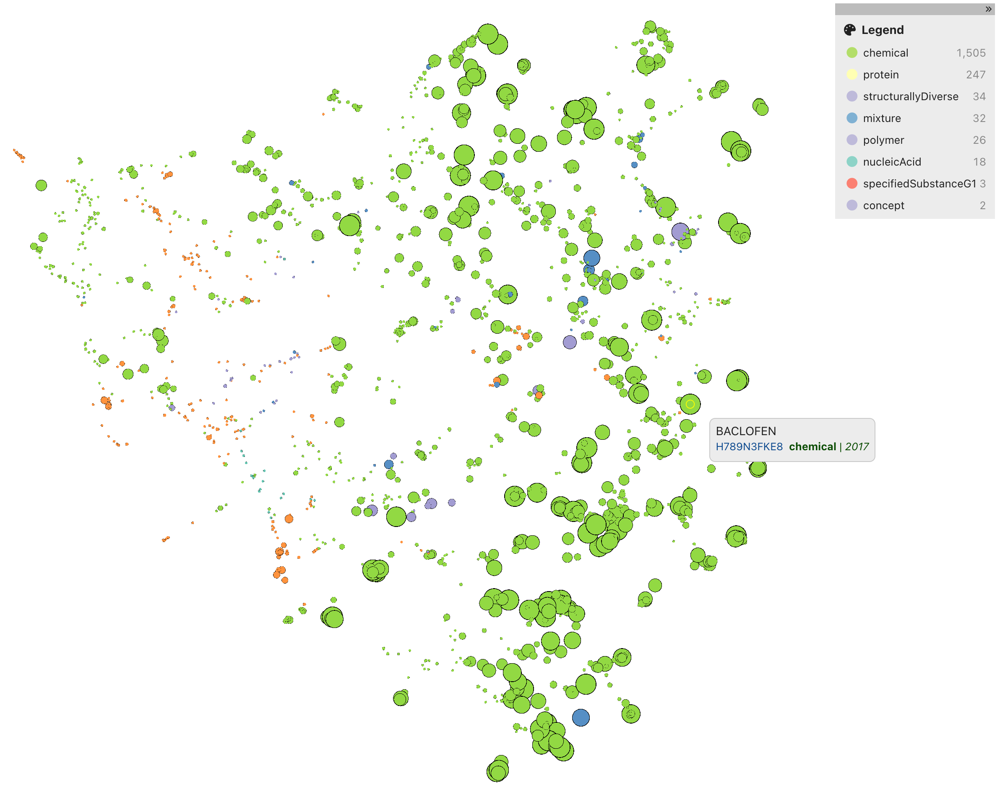

# DrugSpace

Drug embeddings from biomedical literature and drug descriptions. The public release uses openFDA labels and includes 1,867 drug embeddings with 4,096 dimensions.

- [Models](https://huggingface.co/z-cao/DrugSpace-8B)
- [Data, embeddings and reproduction resources](https://doi.org/10.5281/zenodo.23022876)



## Install

Use Python 3.11 and a CUDA-capable PyTorch environment:

```bash
pip install -r requirements.txt
```

Run commands from the repository root. On a cluster, run data processing and model workloads inside the appropriate scheduler allocation.

## Use DrugSpace

```python
from embed import Encoder

encoder = Encoder("drugspace")
vectors = encoder.encode([
    "A selective serotonin reuptake inhibitor used to treat depression.",
    "A beta-adrenergic receptor antagonist used to treat hypertension.",
])
print(vectors.shape)  # (2, 4096)
print(vectors[0] @ vectors[1])  # cosine similarity
```

For a CSV containing a `description` column:

```bash
python embed.py --input data/drugs.csv --output outputs/embeddings
```

The output contains normalized `embeddings.npy` and `metadata.csv` in matching row order. For the released openFDA multi-view embeddings, use `openfda_drugs.csv` and `build_release.py` from Zenodo: normalize each text-view embedding, average the views for each drug, then normalize again. The release also includes the fixed openFDA training triplets and MNTP PMID splits. See [Tutorial.ipynb](Tutorial.ipynb) for nearest-neighbor retrieval from the released embeddings.

```bash
python -m venv .venv-gemma
source .venv-gemma/bin/activate
pip install torch==2.6.0 transformers==4.57.1 sentence-transformers==5.1.1 numpy==1.26.4 pandas==2.2.3 scipy==1.10.1
```

For robustness in this optional environment, also install the pinned `spacy`, `scispacy` and `en_core_sci_sm` entries from `requirements.txt`.

</details>

Authenticate with Hugging Face for gated models after obtaining access to their model repositories.

## Reproduce the DrugBank model

Users with DrugBank access can generate the fixed triplets from their licensed XML and train Stage II locally. For the evaluation model, use DrugBank v5.1.5 (2020-01-03) and the pre-2020 MNTP base:

```bash
python data_process/parse_drugbank.py \
  --input "data/drugbank_v5.1.5.xml" \
  --output data/reference.csv --triplets data/triplets.jsonl

pip install flash-attn==2.7.4.post1 --no-build-isolation

torchrun --standalone --nproc_per_node=2 train.py \
  --triplets data/triplets.jsonl --output outputs/drugbank-eval
```

The parser uses six text fields, filters fields shorter than 20 words, deduplicates text within each drug, masks drug names and samples structure-based hard negatives (Morgan radius 2, 2,048 bits; Tanimoto 0.6–0.95). It writes one fixed triplet file, reused throughout training.

Training uses 20 epochs, global batch 64 (32 per GPU), learning rate 1e-4, 300 warmup steps, seed 42, HardNegativeNLLLoss with scale 50, and LoRA rank 16 / alpha 32 / dropout 0.05. Complete batches are shuffled once and repeated; the final adapter is saved in the output directory. The v5.1.5 input produces 3,415 triplets, 3,392 training rows after dropping the incomplete batch, and 1,060 optimizer steps.

For the full DrugBank model, generate triplets from v5.1.14 (exported 2026-01-04) and pass `--base-model z-cao/DrugSpace-mntp-8B` to the same training command. Use this base as `--model-path` when loading that adapter.

## Evaluation

Parse both licensed snapshots. queries are IDs absent from the reference snapshot with creation date after 2020-01-03:

```bash
python data_process/parse_drugbank.py \
  --input "data/drugbank_v5.1.5.xml" --output data/reference.csv
python data_process/parse_drugbank.py \
  --input "data/drugbank_v5.1.14.xml" --output data/later.csv
```

**Target similarity.** Extract `target_based_evaluation_triplets.csv` from Zenodo's `evaluation_resources.zip`. The constructor joins its fixed IDs to the local descriptions and masks human target gene names:

```bash
python data_process/construct_target_eval_dataset.py \
  --reference data/reference.csv --later data/later.csv \
  --triplet-ids data/target_based_evaluation_triplets.csv --output data/target_triplets.csv
python evaluation/target_similarity_eval.py \
  --input data/target_triplets.csv --output results/target
```

Reports pairwise accuracy, raw and jointly min–max-normalized margins, and 95% intervals from 10,000 anchor-clustered bootstrap samples (seed 42).

**ATC retrieval.** Uses all ATC codes per drug; relevance means sharing any level-1 category represented by at least ten reference drugs. Reports Hits@1/5/10, Precision@5/10 and MRR:

```bash
python evaluation/atc_retrieval_eval.py \
  --reference data/reference.csv --later data/later.csv --output results/atc
```

**Robustness.** The sentence splitter is included in `requirements.txt`:

```bash
python evaluation/robustness_eval.py \
  --reference data/reference.csv --later data/later.csv --output results/robustness
```

Uses sentence shuffling and deletion of 10%, 15% or 25% of words in nonoverlapping spans of 1–3 words, with seeds 42–46. Reports top-10 neighbor Jaccard overlap and paired cosine similarity; seeds are averaged within drugs before computing a 95% t interval across drugs. Descriptions shorter than ten characters are excluded; shuffling needs at least two distinct sentences, and deletion needs at least ten words.

Append `--model bert` (or another model from the table) to any evaluation command. For your trained DrugBank model, append `--model drugbank --adapter outputs/drugbank-eval`. Each task saves `scores.csv` and `metrics.json` under its output directory.

## Interactive visualization

Explore the 1,867 released openFDA drug embeddings in [MedViz](https://medviz.org/), colored by GSRS substance class.


